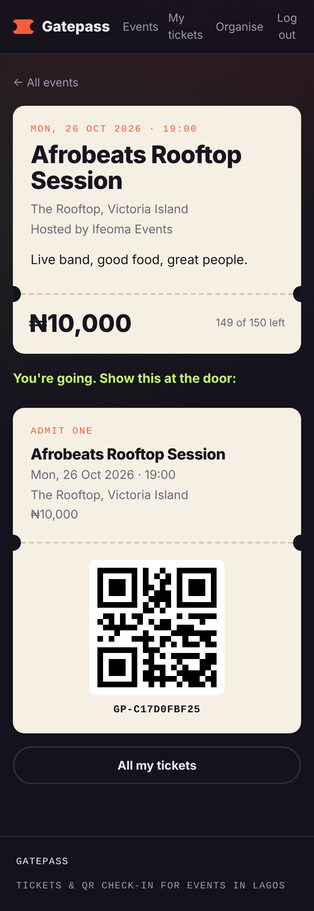
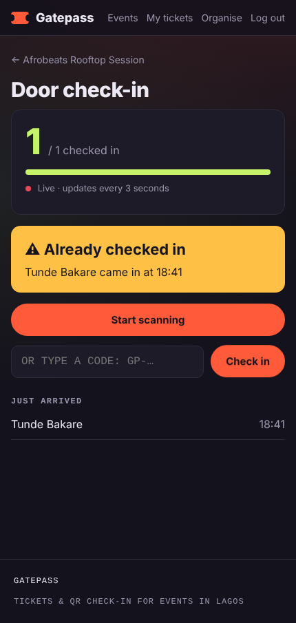
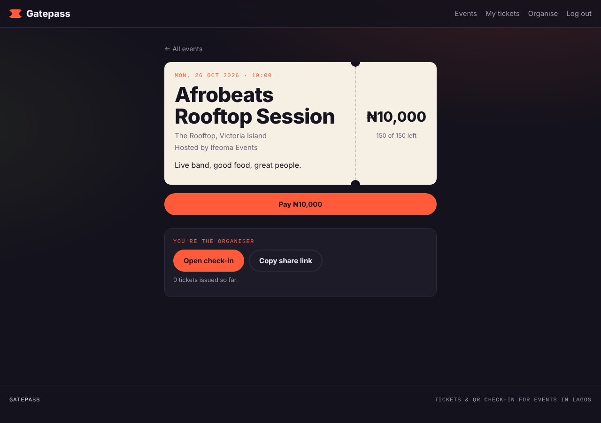

# Gatepass

**Event tickets with QR check-in at the door.**

Organisers create an event and share the link. Attendees register (or pay), and get a ticket with a QR code on their phone. At the door, the organiser scans tickets with their phone camera: valid tickets get in, used or fake ones are rejected, and a live counter shows who has arrived.

**Live app:** https://onimisii1.github.io/gatepass/

| Ticket on a phone | Door check-in | Event page |
|---|---|---|
|  |  |  |

## Features

- **Accounts**: sign up and log in, with bcrypt-hashed passwords and JWT sessions
- **Events**: anyone can host; set the date, venue, capacity and price
- **Tickets**: one per person per event, each with a random, unguessable QR code
- **Payments**: Paystack checkout for paid events, verified server-side (plus a demo mode with no keys needed)
- **Door check-in**: scan with the phone camera, or type the code; ✓ welcome, ⚠ already used, ✕ not valid
- **Live headcount**: checked-in vs registered, refreshing every few seconds across every door
- **Mobile-first design**: built to be used standing at an entrance

## How it works

```
React (GitHub Pages)  ──HTTP/JSON──►  Express API (Render)  ──SQL──►  PostgreSQL (Supabase)
  pages, forms,                         auth, rules,                    users, events,
  QR codes, camera                      payments, check-in              tickets
```

A few details that matter in a real ticketing system:

- **No double entry.** Check-in marks a ticket used in a single SQL statement (`update ... where status = 'valid' returning ...`), so the same ticket scanned on two phones at once is only let in once.
- **No overselling.** Issuing a ticket locks the event row inside a transaction, so two people can't both get the last seat.
- **Payments are verified on the server.** After Paystack checkout, the API asks Paystack directly and checks the amount, currency and account before issuing a ticket. The browser's word is never trusted.
- **The database isn't publicly exposed.** Row Level Security is switched on, so Supabase's public API can't read the tables; all access goes through the Express API's rules.

## Tech

**Front end:** React 19, React Router, Vite, qrcode.react, html5-qrcode, hand-written CSS
**Back end:** Node.js, Express 5, PostgreSQL (`pg`), bcrypt, JSON Web Tokens
**Hosting / CI:** GitHub Pages + GitHub Actions, Render, Supabase

## Project structure

```
client/                 React app (deployed to GitHub Pages)
  src/pages/            Home, AuthPage, CreateEvent, EventPage, MyTickets, Manage, CheckIn
  src/components/       Navbar, EventCard, TicketCard, RequireAuth, PaymentReturn
  src/lib/              api.js (fetch helper), auth.jsx (login state), format.js
server/                 Express API (deployed to Render)
  src/routes/           auth, events, me (tickets + check-in), payments
  src/db.js             database connection + transactions
  src/tickets.js        safe ticket issuing
database/schema.sql     tables, constraints, security
.github/workflows/      builds and publishes the front end
```

## API

| Method | Path | What it does |
|---|---|---|
| POST | `/auth/signup`, `/auth/login` | Create account / log in → token |
| GET | `/auth/me` | Current user |
| GET | `/events`, `/events/:id` | Upcoming events / one event (+ your ticket) |
| POST | `/events` | Create an event |
| POST | `/events/:id/register` | Free ticket |
| POST | `/events/:id/pay` | Start a Paystack payment (or demo payment) |
| POST | `/payments/verify` | Confirm a Paystack payment and issue the ticket |
| GET | `/me/tickets`, `/me/events` | My tickets / events I organise |
| POST | `/checkin` | Scan a ticket code at the door |
| GET | `/events/:id/stats` | Live headcount for the organiser |

## Run it locally

You need Node.js 20+ and a free Supabase project (see the setup steps below).

```bash
# API
cd server
cp .env.example .env      # then fill it in
npm install
npm run dev               # http://localhost:4000

# Front end (in a second terminal)
cd client
cp .env.example .env
npm install
npm run dev               # http://localhost:5173
```

## What I'd build next

- Email tickets to attendees, with the QR attached
- Ticket tiers (Regular / VIP) and promo codes
- Offline check-in that syncs when the connection returns
- Export the guest list as CSV
